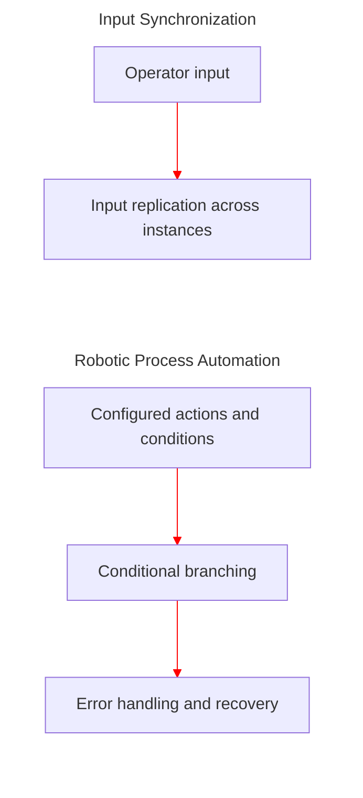
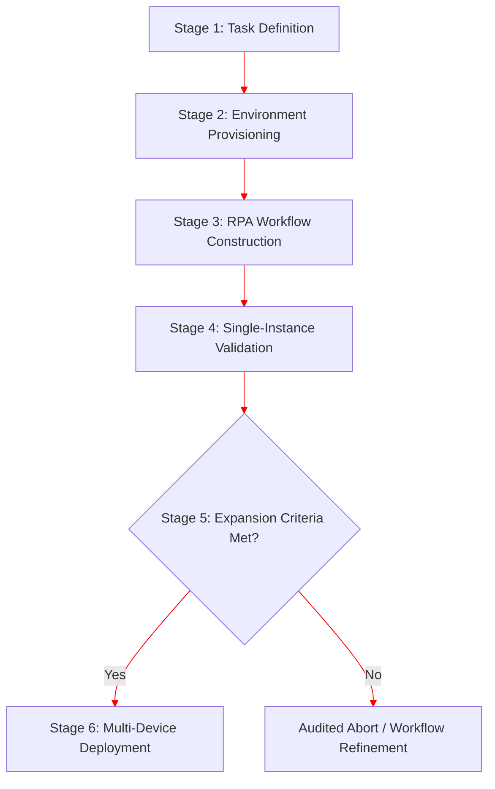
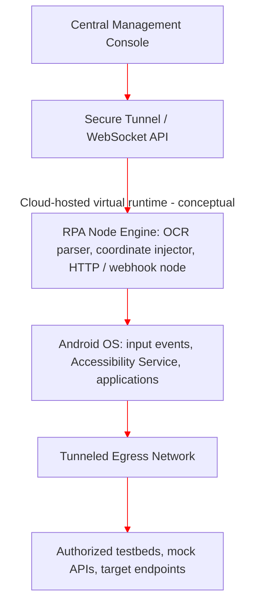
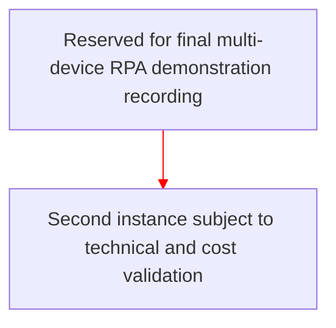

\[[🇧🇷 Português](README.pt_BR.md)\] \[**[🇺🇸 English](README.md)**\]


<br><br>

#### <p align="center">


# <p align="center">

$$
\Huge{
\color{#8B0000}{\textbf{The}}
\space
\color{#A10D0D}{\textbf{Hidden}}
\space
\color{#B91C1C}{\textbf{Game}}
\space
\color{#D12B2B}{\textbf{of}}
\space
\color{#E04444}{\textbf{Digital}}
\space
\color{#F07878}{\textbf{Marketing:}}
}
$$

$$
\LARGE{
\color{#8B0000}{\textbf{Robotic}}
\space
\color{#A10D0D}{\textbf{Process}}
\space
\color{#B91C1C}{\textbf{Automation}}
\space
\color{#D12B2B}{\textbf{(RPA)}}
\space
\color{#E04444}{\textbf{on}}
\space
\color{#E85B5B}{\textbf{Cloud-Hosted}}
\space
\color{#F07878}{\textbf{Android}}
\space
\color{#F59A9A}{\textbf{Devices}}
}
$$

$$
\Large{
\color{#777777}{\textbf{An Analysis}}
\space
\color{#858585}{\textbf{of}}
\space
\color{#949494}{\textbf{Virtual}}
\space
\color{#A3A3A3}{\textbf{Environment}}
\space
\color{#B2B2B2}{\textbf{Isolation}}
\space
\color{#C0C0C0}{\textbf{and}}
\space
\color{#D0D0D0}{\textbf{Cloud}}
\space
\color{#DDDDDD}{\textbf{Economics}}
}
$$

$$
\Large{
\color{#777777}{\textbf{Strategic}}
\space
\color{#868686}{\textbf{and Financial}}
\space
\color{#969696}{\textbf{Analysis}}
\space
\color{#A5A5A5}{\textbf{of Virtual}}
\space
\color{#B4B4B4}{\textbf{Environment}}
\space
\color{#A87878}{\textbf{Isolation in}}
\space
\color{#B87474}{\textbf{Digital Marketing}}
\space
\color{#C87878}{\textbf{and Growth}}
}
$$


<!--

# <p align="center">

$$
\Huge{
\color{#8B0000}{\textbf{O Jogo}}
\space
\color{#A10D0D}{\textbf{Oculto}}
\space
\color{#B91C1C}{\textbf{do}}
\space
\color{#D12B2B}{\textbf{Marketing}}
\space
\color{#E04444}{\textbf{Digital:}}
}
$$

$$
\Huge{
\color{#8B0000}{\textbf{Robotic}}
\space
\color{#A10D0D}{\textbf{Process}}
\space
\color{#B91C1C}{\textbf{Automation}}
\space
\color{#D12B2B}{\textbf{(RPA)}}
\space
\color{#E04444}{\textbf{on}}
\space
\color{#E85B5B}{\textbf{Cloud-Hosted}}
\space
\color{#F07878}{\textbf{Android}}
\space
\color{#F59A9A}{\textbf{Devices}}
}
$$

#### <p align="center">

$$
\Large{
\color{#777777}{\textbf{Análise}}
\space
\color{#858585}{\textbf{de}}
\space
\color{#949494}{\textbf{Isolamento}}
\space
\color{#A3A3A3}{\textbf{de}}
\space
\color{#B2B2B2}{\textbf{Ambientes}}
\space
\color{#C0C0C0}{\textbf{Virtuais}}
\space
\color{#D0D0D0}{\textbf{e}}
\space
\color{#DDDDDD}{\textbf{Economia}}
\space
\color{#E8E8E8}{\textbf{de Nuvem}}
}
$$

# <p align="center">

-->


<br><br>

#

<br><br>


<!-- ========= START TEASER ========= -->
###### <p align="center">   🦾 **Robots that reason ?** Done.</p>

###### <p align="center">  **Robots that collaborate ?** Working on it.*</p>

###### <p align="center">   **Humans that make  ?**  *That's the real AGI challenge...* 

###### <p align="center">    ❤️‍🔥 ***May The Force Be With Us !*** 


### <p align="center">⚡️</p>

<br>

#

<br><br>
<!-- ========= END TEASER ========= -->


<!-- ♡ Sponsor ····· ॐ Mindful AI -->
<p align="center">
  <a href="https://github.com/sponsors/Mindful-AI-Research">
    

<br><br>
<!-- ========= END SPONSOR BADGE ========= -->

<!-- ========= demo: building androids on MoreLogin  + Art========= -->
https://github.com/user-attachments/assets/43dd8864-8ec8-4805-9da5-8b74248815f1

<!--
======= Art 01 =======
https://github.com/user-attachments/assets/9cfdad82-08a5-4ae4-aa8c-ec0d23bfe3d4

https://github.com/user-attachments/assets/a1285801-4bc6-49f5-8814-2f7de04d148e

=======PUC BANNER =======
<p align="center">
   
 </p>
 -->

<br><br>
<!-- =========  END PUC HEADER GIF ========= -->

<!-- ======================================= Start Institucional INFOR =========================================== -->
[**Institution:**]() Pontifical Catholic University of São Paulo (PUC-SP)  <br>
[**School:**]() FACEI — Computer Science Department  <br>
[**Course:**]() BSc in Human-Centered AI & Data Science •  6th Semester • 2026 <br>
[**Subject:**]()  Artificial Intelligence, Robotics & Intelligent Agents ⤳ Research & Consulting   <br>
[**Extensionist Projects: 3**]() Robotic Process Automation (RPA) on Cloud-Hosted Android Devicest <br>
**Prof. Dr.:** ✨ [Sandra Muniz Bozolan](https://www.linkedin.com/in/sandrabozolan/) <br>
**Author:**  [Fabiana ⚡️ Campanari](https://linktr.ee/fabianacampanari)  and [Lucas Moniz]()


<br><br>

#

<br><br>
<!-- ======================================= SZEnd Institutional INFO ===========================================  -->

<!-- ========= START!WARNING ========= -->
> [!WARNING]
>
> ⚠️ Projects may be publicly shared when permitted.  
> The focus is on applied, hands-on learning with real datasets in AI governance and security contexts.  
> All sensitive content remains protected in private repositories when required.
>

<br><br>

#

<br><br>
<!-- ========= END!WARNING ========= -->


<!-- ========= START MAIN REPO / Projects REFERENCES ========= -->
> [!TIP]
>
> This repository is part of the main ecosystem:
>
> ## 🦾🤖🪽 Artificial Intelligence ✦ Robotics & Intelligent Agents  ✦ Hub   
>
> Explore the complete collection of projects, notebooks, research materials, analyses and interactive applications available in the central repository:
>
> 🔗 **[Artificial Intelligence ✦ Robotics & Intelligent Agents ✦ Hub](https://github.com/Mindful-AI-Research/1-ai-robotics-intelligent-agents-consulting-hub)**
>
> #
>
> ###  Related Project in this Series:
>
> 🔗 **[Project 2 - Projects: 2**]()  ⤳ [HabitSync: AI Recommendation Agent](https://github.com/Mindful-AI-Research/2-ai-robotics-intel-agents_project-habitsync)**
>
> A deep learning system for handwritten character recognition using PyTorch and Streamlit.

<br><br>
<!-- ========= END MAIN REPO / Projects REFERENCES ========= -->


## 📌 Table of Contents

- [1. Executive Overview](#1-executive-overview)
- [2. Research Problem & Conceptual Framework](#2-research-problem--conceptual-framework)
- [3. Methodological Pipeline](#3-methodological-pipeline)
- [4. Mathematical Foundations of RPA & Cost Models](#4-mathematical-foundations-of-rpa--cost-models)
- [5. System Architecture & Component Flow](#5-system-architecture--component-flow)
- [6. Audiovisual Evidence & Demonstrations](#6-audiovisual-evidence--demonstrations)
  - [Cloud Android Technical Demonstrations](#cloud-android-technical-demonstrations)
  - [Physical Phone Farm Comparative Taxonomy](#physical-phone-farm-comparative-taxonomy)
  - [Third-Party Technical RPA Tutorials](#third-party-technical-rpa-tutorials)
- [7. Cloud Phone Multi-Platform Benchmark Matrix](#7-cloud-phone-multi-platform-benchmark-matrix)
- [8. Cybersecurity, Threat Intelligence & OSINT Attribution](#8-cybersecurity-threat-intelligence--osint-attribution)
- [9. Legal Governance, Ethics & LGPD Compliance](#9-legal-governance-ethics--lgpd-compliance)
- [10. Reproducibility & Environment Setup](#10-reproducibility--environment-setup)
- [11. Evaluation Criteria & Future Milestones](#11-evaluation-criteria--future-milestones)
- [12. References & Academic Citations](#12-references--academic-citations)

<br><br>

## 1. [Executive Overview]()

Robotic Process Automation (RPA) in mobile environments historically required physical hardware setups: clusters of smartphones connected via USB hubs, controlled through ADB (Android Debug Bridge) or manual operator input. While effective for simple test automation, physical installations suffer from severe structural constraints, including thermal throttling, lithium battery degradation, high electrical overhead, and catastrophic maintenance complexity.

This research establishes a rigorous methodology for planning, configuring, and benchmarking RPA workflows deployed directly on **Cloud-Hosted Android Virtual Devices (Cloud Phones)**. Treating platforms such as MoreLogin, PhoneGrid, and DuoPlus as third-party candidates subject to documentary, technical, and budgetary verification, the project decouples mobile automation from local hardware constraints.

<br><br>




<br><br>

## 2. [Research Problem & Conceptual Framework]()

When mobile automation migrates to virtualized cloud instances, three core engineering challenges arise:

1. **Virtualization Fidelity & Anti-Detection:** Cloud phones execute inside ARM/x86 hypervisors or containerized Android runtimes. Mobile applications and web portals actively fingerprint system attributes (OpenGL renderers, sensor telemetry, battery state, baseband build tags) and network characteristics (datacenter IP ranges, ASN categorization).

2. **Deterministic UI State Transitions:** Mobile screens are dynamic. Network latency and asynchronous UI rendering require robust synchronization barriers, visual anchors, and optical character recognition (OCR) rather than hardcoded coordinate clicks.

3. **Operational Economics:** Physical hardware requires high initial Capital Expenditure (CapEx) with low marginal execution cost. Cloud phones invert this model into Operational Expenditure (OpEx), billing per device-hour or execution-minute. Scaling requires rigorous cost modeling prior to multi-instance expansion.

<br><br>

## 3. [Methodological Pipeline]()

The proposed experimental framework consists of six sequential, auditable stages:




<br><br>

1. **Stage 1 · Synthetic Task Definition:** Specification of elementary operations (launch application, navigate hierarchy, parse text element, write mock log) using exclusively synthetic datasets.

2. **Stage 2 · Android Cloud Provisioning:** Preparation of a test environment using an Android version confirmed as available by the provider; inspection of outbound routing and baseline environment properties.

3. **Stage 3 · Visual RPA Graph Construction:** Mapping logical execution blocks, setting coordinate offsets, defining OCR search regions, and configuring deterministic wait loops.

4. **Stage 4 · Single-Instance Validation:** Execution of sequential iterations to measure end-to-end latency, state error frequency, and effective minute consumption.

5. **Stage 5 · Conditional Expansion Assessment:** Formal evaluation against budgetary constraints, stability thresholds (\({\color{#D12B2B} P_s \ge 0.95}\)), and infrastructure resource availability.

6. **Stage 6 · Multi-Device Verification:** Controlled deployment across secondary instances to assess concurrency overhead and synchronization divergence.


<br><br>


## 4. [Mathematical Foundations of RPA & Cost Models]()

<br>

> Technical status: the equations below are planning models, not measured reliability or billing results. Independence and billing assumptions must be checked before applying them.

 <br>

### Operational Reliability Model

For a workflow consisting of ${\color{#D12B2B} k}$ sequential independent sub-tasks, overall execution reliability ${\color{#D12B2B} R_{\text{total}}}$ is modeled as:

<br><br>

$$
{\color{#D12B2B}
R_{\text{total}} = \prod_{i=1}^{k} \left(1 - P_f(i)\right)
}
$$

<br>

Where ${\color{#D12B2B} P_f(i)}$ represents the probability of failure at step ${\color{#D12B2B} i}$ due to network jitter, UI desynchronization, or unresolved CAPTCHA challenges. When conditional retry logic with ${\color{#D12B2B} m}$ attempts is implemented:

<br><br>

$$
{\color{#D12B2B}
R_{\text{step}} = 1 - \left(P_f(i)\right)^m
}
$$

<br>

### OpEx vs. CapEx Financial Model

The economic viability of transitioning from physical hardware farms to cloud-hosted infrastructure is evaluated by comparing total cost functions over operational timeframe ${\color{#D12B2B} T}$ (hours):

<br><br>


```math
{\color{#D12B2B}
C_{\mathrm{physical}}(T) = \mathrm{CapEx}_{\mathrm{hardware}} + \sum_{t=1}^{T} \left(P_{\mathrm{energy}}(t) + C_{\mathrm{maintenance}}(t) + C_{\mathrm{bandwidth}}(t)\right)
}
```

<br><br>

```math
{\color{#D12B2B}
C_{\mathrm{cloud}}(T) = N \cdot \left(R_{\mathrm{device,base}} + \int_{0}^{T} r_{\mathrm{minute}}(t)\,dt\right) + C_{\mathrm{proxy,egress}}
}
```


<br><br><br>

Where ${\color{#D12B2B} N}$ is the number of active virtual instances, ${\color{#D12B2B} r_{\mathrm{minute}}}$ is the variable per-minute execution tariff, and ${\color{#D12B2B} R_{\mathrm{device,base}}}$ represents the fixed monthly profile reservation fee.


<br><br>


## 5. [System Architecture & Component Flow]()

<br>

> Conceptual architecture: ARM/KVM, WebSocket, Tesseract, Accessibility Service, and named node types in this diagram are illustrative, not verified specifications of the candidate providers.

<br>



<br><br>

## 6. [Audiovisual Evidence & Demonstrations]()

<br>

> Media status: the file names below are catalog entries from the supplied README. Their presence here does not confirm that the media was provided, inspected, or executed by the authors.


<br><br>

### ***Cloud Android Technica***

<br>

| Demonstration | File Name | Environment / Platform | Core Objective & Demonstrated Actions |
|:---:|---|:---:|---|
| **Demo 01** | `Demo-01_ install-proxies_isolating-profiles.mp4` | MoreLogin Management Console | **Proxy Allocation & Profile Isolation:** Configuration of advanced browser/runtime profiles, digital fingerprint refresh, SOCKS5/datacenter/residential proxy binding, and connectivity validation. |
| **Demo 02** | `Demo-02_adding p-proxies_genating-cloud-phones.mp4` | PhoneGrid Cloud Phone Engine | **Cloud Phone Spawning & Concurrency:** SOCKS5 proxy integration, US/Brazil timezone matching, network verification, simultaneous multi-device boot (Android 15A runtimes), and parallel container shutdown. |

<br><br>



<br><br>

### ***Physical Phone Farm Comparative Taxonomy***

<br>

| Code | Standardized File | Infrastructure Architecture | Operational Mechanism | Technical Limitations & Risks |
|:---:|---|---|---|---|
| **VF-01** | `farm_fisica_01_macae_policia.mp4` | Residential wall-mounted cluster (Macaé/RJ) | Continuous loop playback | High thermal fire hazard, chaotic wiring, total exposure to physical seizure (Brazilian Penal Code Art. 171). |
| **VF-02** | `farm_fisica_02_rack_motherboards.mp4` | 1U server chassis with 20 phone motherboards | Synchronized batch mirroring | Fragile manual wiring, hot-glue soldering, total lack of physical displays for troubleshooting. |
| **VF-03** | `farm_fisica_03_cnc_robotic_rig.mp4` | Cartesian CNC gantry with capacitive stylus | Sequential physical touch | Extreme mechanical latency, high wear on stepper motors, severe physical scaling bottleneck. |
| **VF-04** | `farm_fisica_04_datacenter_industrial_racks.mp4` | Industrial datacenter aisle with slide racks | Parallel mass device operation | Massive CapEx overhead, extreme electrical consumption, high visibility to regulatory scrutiny. |

<br><br>

### Third-Party Technical RPA Tutorials

<br>

| ID | Module Name | Core Technical Focus | Official Source |
|:---:|---|---|:---:|
| **S1-V01** | Workflow Initialization | Graph workspace navigation and first node deployment | [Watch Tutorial](https://www.youtube.com/watch?v=vF1XkAt6BE0) |
| **S1-V02** | Scheduler Configuration | Cron-like triggers, execution intervals, and loops | [Watch Tutorial](https://www.youtube.com/watch?v=l3asV-WxZNM) |
| **S1-V03** | Visual Node Hierarchy | Node inspector, UI anchor detection, coordinate maps | [Watch Tutorial](https://www.youtube.com/watch?v=aVUagtL8no0) |
| **S1-V04** | Variable Parameterization | Dynamic input fields, JSON data injection, environment vars | [Watch Tutorial](https://www.youtube.com/watch?v=TFvL4iv9mdA) |
| **S1-V05** | UI Interaction Primitives | Tap, hold, swipe, text input, keyboard dispatch | [Watch Tutorial](https://www.youtube.com/watch?v=MsjL2UE8l_c) |
| **S1-V06** | OCR & Vision Anchors | Image template matching and on-screen text recognition | [Watch Tutorial](https://www.youtube.com/watch?v=_ZqNGFrAOMk) |
| **S1-V07** | Branching & Logic Gates | Conditional statements (IF/ELSE), timeout exceptions, retries | [Watch Tutorial](https://www.youtube.com/watch?v=vHF2MqFr3UI) |
| **S1-V08** | Advanced HTTP & JS | Webhook integration and asynchronous script execution | [Watch Tutorial](https://www.youtube.com/watch?v=Y0U2V54Lr98) |
| **S2-V02** | Cloud Phone Synchronizer | Master-slave real-time input replication | [Watch Tutorial](https://www.youtube.com/watch?v=dLAuG8IMgKE) |
| **S2-V04** | Batch Asset Operations | Multi-device bulk file transfer and clipboard broadcasting | [Watch Tutorial](https://www.youtube.com/watch?v=7wQsy16vXC4) |


<br><br>

# 7. [Cloud Phone Multi-Platform Benchmark Matrix]()


<br><br>

> Candidate-comparison worksheet, not an executed benchmark. Architecture, capabilities, synchronization behavior, prices, allowances, and availability require dated provider documentation before use.


<br><br>[

| Evaluation Dimension | MoreLogin Cloud Phone | PhoneGrid | DuoPlus Cloud Phone | iOS Farm (Handler / Open-Source) |
|---|---|---|---|---|
| **Underlying Architecture** | Managed Cloud Container | Remote Cloud Android VM | Anti-Detect Cloud Android | Physical iPhones + Mac Host |
| **RPA Capabilities** | Visual Node Graph + Marketplace | Template Workflows + Custom API | Pre-built templates + Custom Flow | WebDriverAgent / Appium API |
| **Input Synchronization** | Native Master-Slave tool | Dedicated Syncer tool | Multi-window Syncer tool | Browser-based live broadcast |
| **Pricing Model** | Tiered Subscription + Usage | Free Tier (100m) + $0.006/min | Profile Base Fee + Runtime Packs | Self-Hosted (Free code, high hardware cost) |
| **Academic Viability** | Primary baseline under evaluation | Recommended candidate alternative | Recommended candidate alternative | Comparative reference for self-hosting |


<br><br>
